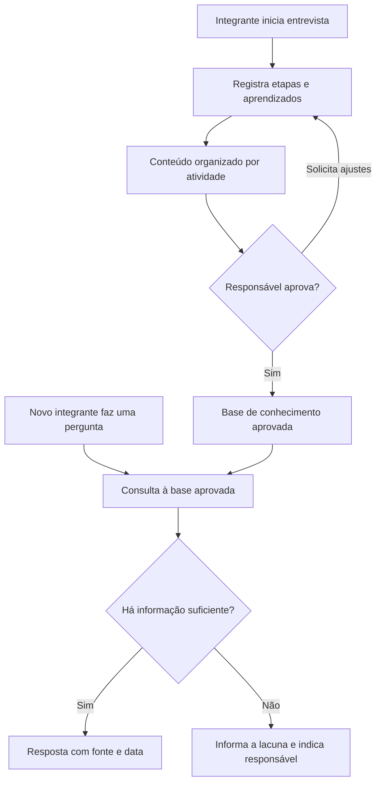
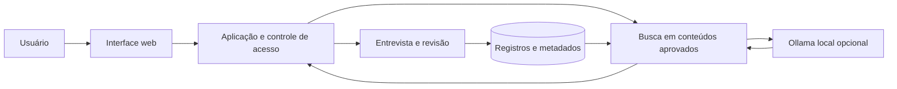

<div align="center">

# 🤝 Passa o Bastão

### Chatbot para transferência de conhecimento em projetos universitários

**Inteligência artificial · Memória organizacional · Conversação · Revisão humana**


</div>

## 📌 Visão geral

O **Passa o Bastão** é uma proposta de chatbot que preserva experiências de integrantes de projetos universitários e ajuda novos membros a assumir atividades. A solução combina uma entrevista guiada para registrar conhecimento, revisão por um responsável e consulta por perguntas em linguagem natural.

Em empresas juniores, atléticas, centros acadêmicos e projetos de extensão, a saída de integrantes pode deixar lacunas sobre processos, decisões e dificuldades já resolvidas. A proposta é transformar parte desse conhecimento em orientações consultáveis, com autoria e data identificáveis.

O protótipo roda localmente com uma SPA React e uma API Python. Ele permite registrar entrevistas e documentos, revisar e versionar os registros e consultar trechos aprovados com fonte e data.

## 🧭 Sumário

- [Problema e objetivos](#problema-e-objetivos)
- [Recorte e público-alvo](#recorte-e-publico-alvo)
- [Funcionamento e diferencial](#funcionamento-e-diferencial)
- [Escopo e requisitos](#escopo-e-requisitos)
- [Arquitetura e tecnologias](#arquitetura-e-tecnologias)
- [Interfaces e dados](#interfaces-e-dados)
- [Validação e critérios de aceite](#validacao-e-criterios-de-aceite)
- [Planejamento e entregáveis](#planejamento-e-entregaveis)
- [Organização e uso do repositório](#organizacao-e-uso-do-repositorio)
- [Equipe e contexto acadêmico](#equipe-e-contexto-academico)
- [Referências](#referencias)

<a id="problema-e-objetivos"></a>
## 🎯 Problema e objetivos

**Problema central:** como registrar o conhecimento de quem deixa uma equipe e permitir que novos integrantes encontrem orientações confiáveis para assumir suas responsabilidades?

A hipótese é que uma entrevista guiada facilita o registro de etapas, exceções e aprendizados que poderiam não aparecer em uma documentação espontânea. Essa hipótese será avaliada no piloto.

**Objetivo geral:** desenvolver um protótipo de chatbot para registrar, organizar e disponibilizar conhecimento sobre atividades de um projeto universitário.

**Objetivos específicos:**

- Coletar relatos sobre atividades, dificuldades, decisões e recomendações.
- Organizar os registros por atividade, autor e data.
- Permitir revisão humana antes de liberar conteúdos para consulta.
- Responder perguntas usando informações aprovadas e indicando suas fontes.
- Reconhecer dúvidas que a base ainda não consegue responder.
- Avaliar a utilidade das orientações para um novo integrante.

<a id="recorte-e-publico-alvo"></a>
## 👤 Recorte e público-alvo

| Definição | Planejamento inicial |
|---|---|
| Unidade do piloto | Um único projeto universitário, a selecionar |
| Atividades cobertas | Conjunto pequeno de atividades, definido com a equipe participante |
| Fontes iniciais | Entrevistas e documentos autorizados do projeto |
| Resultado esperado | Protótipo que demonstre registro, revisão e consulta de conhecimento |
| Parceria | Nenhuma parceria confirmada até o momento |

| Perfil | Responsabilidade prevista |
|---|---|
| Integrante que registra conhecimento | Responder à entrevista e conferir o próprio relato |
| Novo integrante | Consultar orientações e apontar dúvidas ou informações incompletas |
| Responsável pelo projeto | Revisar conteúdos e manter os registros atualizados |

Uma mesma pessoa pode acumular papéis. A API aplica a [matriz de permissões](docs/arquitetura.md#permissões) a cada operação.

<a id="funcionamento-e-diferencial"></a>
## 💬 Funcionamento e diferencial

O chatbot atuará em dois momentos: na coleta do conhecimento e na consulta por quem precisa executar uma atividade.

### Exemplo de entrevista

> **Bot:** Qual atividade você executava e que outra pessoa precisará assumir?
>
> **Integrante:** Eu organizava as inscrições da feira.
>
> **Bot:** Quais eram as etapas? Qual delas costumava causar problemas?
>
> **Integrante:** Algumas pessoas não recebiam a confirmação.
>
> **Bot:** Como vocês identificavam e resolviam isso?

Depois, um novo integrante poderá perguntar: **“Vou organizar as inscrições da próxima feira. Por onde começo e o que preciso conferir?”**

A resposta deverá reunir as orientações aprovadas e identificar sua origem e data. Quando faltar informação, o bot deverá explicitar a lacuna e indicar o responsável cadastrado pelo assunto, quando disponível.

### Fluxo proposto



O diferencial proposto é que o chatbot também ajuda a construir sua base de conhecimento. A entrevista busca registrar como o trabalho acontece, incluindo dificuldades e decisões que precisam ser contextualizadas.

<a id="escopo-e-requisitos"></a>
## 📋 Escopo e requisitos

### Requisitos funcionais da primeira versão

| ID | Funcionalidade | Comportamento esperado |
|---|---|---|
| RF01 | Identificação e perfis | Distinguir quem registra, consulta e revisa conteúdos |
| RF02 | Entrevista guiada | Conduzir perguntas sobre etapas, dificuldades e recomendações |
| RF03 | Organização dos relatos | Relacionar registros a atividades, autores e datas |
| RF04 | Revisão humana | Aprovar, solicitar ajustes ou retirar conteúdo de consulta |
| RF05 | Consulta conversacional | Responder perguntas com base em registros aprovados |
| RF06 | Indicação de fontes | Exibir a origem e a data das informações utilizadas |
| RF07 | Tratamento de lacunas | Informar quando a base não oferece uma resposta suficiente |
| RF08 | Atualização de conhecimento | Permitir revisar registros que ficaram desatualizados |

### Requisitos de qualidade

- Interface compreensível para usuários sem conhecimento técnico.
- Preservação de autoria, data e situação de revisão dos registros.
- Aplicação das permissões no acesso aos dados e nas consultas do chatbot.
- Respostas vinculadas às informações disponíveis, com indicação de lacunas.
- Configurações e credenciais separadas dos arquivos versionados.

### Fora do escopo inicial

- Integração automática com WhatsApp, e-mail ou sistemas institucionais.
- Execução de tarefas em nome dos integrantes.
- Atendimento simultâneo a várias organizações.
- Treinamento de um modelo de linguagem próprio.

<a id="arquitetura-e-tecnologias"></a>
## 🏗️ Arquitetura e tecnologias

A aplicação separa o registro de conteúdo, a revisão e a recuperação de trechos aprovados.



| Camada | Implementação |
|---|---|
| Interface | React com Vite |
| Aplicação | Python com Flask e autenticação Bearer JWT |
| Armazenamento | MongoDB com PyMongo |
| Busca | Correspondência lexical em versões aprovadas e autorizadas |
| Inteligência artificial | Ollama local opcional para selecionar trechos recuperados |
| Demonstração | Frontend e API em localhost |

Confira o modelo de dados, as transições de estado, a busca e o contrato da API na [documentação de arquitetura](docs/arquitetura.md).

<a id="interfaces-e-dados"></a>
## 🖥️ Interfaces e dados

### Telas

1. Identificação do usuário e de sua função.
2. Conversa para entrevista de passagem.
3. Revisão dos relatos e acompanhamento de aprovação.
4. Conversa para consulta, com fontes e datas.
5. Consulta e atualização dos registros por atividade.

### Informações registradas

| Registro | Campos iniciais |
|---|---|
| Integrante | Identificador, nome e função |
| Atividade | Título, descrição e responsável de referência |
| Relato | Conteúdo, atividade, autor, data e situação de revisão |
| Fonte documental | Título, origem, data e atividade relacionada |
| Revisão | Responsável, decisão, observação e data |

O roteiro pergunta sobre etapas, recursos, dificuldades, soluções, decisões e recomendações.

### Cuidados com as informações

O piloto deverá usar relatos e documentos autorizados, coletando apenas os dados necessários. Informações de terceiros sem autorização, senhas e credenciais não devem ser incluídas na base. Antes de usar serviços externos de IA, a equipe deverá definir quais dados poderão ser enviados, quem poderá consultá-los e como solicitar correção ou remoção.

Dados fictícios poderão ser utilizados nas primeiras demonstrações, identificados como exemplos.

<a id="validacao-e-criterios-de-aceite"></a>
## ✅ Validação e critérios de aceite

A validação proposta consiste em registrar uma atividade com alguém que a conhece e pedir a um novo integrante que busque orientações pelo chatbot. A equipe deverá preparar perguntas de referência, inclusive perguntas cujas respostas não estejam na base.

| Cenário de avaliação | Critério de aceite previsto |
|---|---|
| Conteúdo aguardando revisão | Não aparece nas respostas de consulta |
| Pergunta coberta pela base | Resposta compatível com o conteúdo aprovado, com fonte e data |
| Pergunta sem informação suficiente | Bot informa a lacuna sem inventar uma orientação |
| Conteúdo retirado de consulta | Deixa de ser utilizado nas respostas seguintes |
| Usuário sem permissão de revisão | Não consegue aprovar conteúdos |
| Novo integrante consulta uma atividade | Consegue localizar as etapas registradas e identificar dúvidas restantes |

Os [resultados da validação técnica](docs/validacao.md) registram as perguntas, as fontes e as lacunas da demonstração fictícia. A avaliação com integrantes de um projeto participante ainda está pendente.

<a id="planejamento-e-entregaveis"></a>
## 🗺️ Planejamento e entregáveis

- [x] Definir a ideia e o recorte inicial.
- [x] Documentar a proposta no README.
- [ ] Selecionar o projeto participante e validar o problema com seus integrantes.
- [ ] Levantar soluções similares e comparar pelo menos três alternativas.
- [x] Definir o roteiro da entrevista e os requisitos do MVP.
- [x] Implementar as interfaces e o modelo de dados.
- [x] Definir tecnologias, permissões e tratamento das informações.
- [x] Implementar entrevista, revisão e consulta.
- [x] Executar os cenários técnicos de validação com dados fictícios.
- [x] Preparar a demonstração local e a documentação do MVP.

| Entregável previsto | Conteúdo |
|---|---|
| Pré-projeto | Problema, objetivos, público e escopo |
| Levantamento de similares | Comparação de funcionalidades, limites e contribuição proposta |
| Documentação da solução | Requisitos, fluxos, arquitetura e modelo de dados |
| Protótipo das interfaces | Telas de entrevista, revisão e consulta |
| Aplicação demonstrável | Fluxo de passagem de uma atividade entre integrantes |
| Registro de avaliação | Cenários executados, resultados e limitações |
| Apresentação | Contexto, demonstração e aprendizados do projeto |

<a id="organizacao-e-uso-do-repositorio"></a>
## 📁 Organização e uso do repositório

```text
.
├── README.md
├── backend/          # API Python, persistência e testes
├── frontend/         # SPA React e testes de navegador
└── docs/             # Arquitetura, roteiro de demonstração e resultados
```

### Clonar o projeto

```bash
git clone https://github.com/vinni-lacerda/AV3-chatbot-academico.git
cd AV3-chatbot-academico
```

Para usar uma pasta local com outro nome:

```bash
git clone https://github.com/vinni-lacerda/AV3-chatbot-academico.git "chatbot IA"
cd "chatbot IA"
```

### Instalação e execução

Use Python 3.11 ou superior, Node.js 22.12 ou superior e Docker Compose para iniciar o MongoDB. Com um MongoDB local já disponível, configure `MONGODB_URI` em `backend/.env` e pule o comando do Docker.

Em um terminal PowerShell, a partir da raiz do repositório:

```powershell
cd backend
docker compose up -d mongodb
python -m venv .venv
.\.venv\Scripts\python.exe -m pip install -r requirements.txt
Copy-Item .env.example .env
$env:MONGODB_DB_NAME = "passa_o_bastao_demo"
$env:PYTHONPATH = "src"
.\.venv\Scripts\python.exe -m infrastructure.persistence.demo
.\.venv\Scripts\python.exe -m flask --app main run --host 127.0.0.1 --port 8000
```

Em Linux ou macOS, use `.venv/bin/python`, `cp .env.example .env` e `export MONGODB_DB_NAME=passa_o_bastao_demo PYTHONPATH=src` nas etapas equivalentes.

Em outro terminal, a partir da raiz:

```powershell
cd frontend
Copy-Item .env.example .env
npm.cmd ci
npm.cmd run dev
```

Em Linux ou macOS, use `cp` e `npm`. Abra [http://localhost:5173](http://localhost:5173). O indicador na tela inicial consulta `GET /api/v1/health` e mostra o estado da conexão. O endpoint retorna HTTP 200 com `{"status":"ok","service":"passa-o-bastao-backend"}`.

As três contas fictícias usam a senha `Bastao-Demo-2026!` na base local de demonstração.

| Perfil | E-mail |
|---|---|
| Integrante que registra | `lia@demo.example` |
| Responsável pela revisão | `beto@demo.example` |
| Ada Wong - Demo · Novo integrante que consulta | `ada@demo.example` |

`VITE_API_URL` configura a URL da API. Se a porta 8000 estiver ocupada, escolha outra em `--port` e atualize `VITE_API_URL` em `frontend/.env`. Se mudar a origem do frontend, ajuste `CORS_ALLOWED_ORIGINS` em `backend/.env`. `MONGODB_URI` e `JWT_SECRET_KEY` são configurações do backend. O Ollama pode ser ativado apenas no backend conforme o [roteiro de demonstração](docs/demonstracao.md).

### Organização das contribuições

Como convenção inicial, cada tarefa deverá ter objetivo, responsável e critério de conclusão. Sugere-se trabalhar em branches por atividade, descrever as alterações em pull requests e manter a documentação alinhada ao que foi implementado. Credenciais e relatos privados não devem ser enviados ao repositório.

<a id="equipe-e-contexto-academico"></a>
## 👥 Equipe e contexto acadêmico

### Integrantes

Preencher os demais membros da equipe e ajustar a quantidade de linhas conforme o grupo. As responsabilidades de desenvolvimento serão combinadas após a definição das atividades.

| Integrante | Nome completo | RA | Responsabilidade |
|:--:|---|---|---|
| 1 | Vinicius Lacerda Santos | 12725210686 | A definir |
| 2 | Hiago da Silva Lins Goncalves | 12525163385 | A definir |
| 3 | Leoni Lucas Mascarenhas Silva | 12725156424 | A definir |
| 4 | Rafael Stolf Silva  | 122515186 | A definir |
| 5 | Pedro Murilo Pereira  | 122519964 | A definir |

<a id="referencias"></a>
## 📚 Referências

- **Pré-Projeto UC HUB:** modelo fornecido para organizar integrantes, similares, usuários, processos e interfaces da proposta.
- **Batista et al. (2020).** [Mobile Applications and Discrete Event Systems: Low Cost Technology to Assist Stock Management in an Orthopaedic Clinic](https://www.dpublication.com/wp-content/uploads/2020/02/2-13982.pdf). Referência metodológica para levantamento de processos, requisitos e fluxos. O domínio de estoque do artigo não faz parte do escopo deste chatbot.

Outras referências e soluções similares serão acrescentadas após a pesquisa da equipe.
