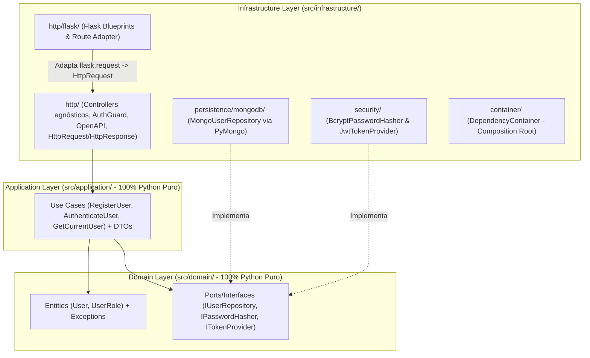

# 🏗️ Backend — Passa o Bastão (Clean Architecture Agnóstica + SOLID + Flask + MongoDB)

Este diretório contém o backend em Python do projeto **Passa o Bastão**, projetado para ser **estritamente agnóstico a bibliotecas externas** em suas camadas de negócio (`domain` e `application` usam **100% Python padrão / stdlib**), enquanto toda entrega HTTP (incluindo os controllers agnósticos, documentação OpenAPI/Swagger e o adaptador do **Flask**), persistência (**MongoDB**) e criptografia ficam na camada `infrastructure/`.

---

## 🧭 Arquitetura em 3 Camadas (`domain`, `application`, `infrastructure`)



---

## 📁 Estrutura de Diretórios

```text
backend/
├── Dockerfile                       # Imagem da API com execução automática de seed
├── docker-compose.yml               # Orquestração MongoDB 7 + Backend Flask
├── Makefile                         # Automação (liberação de portas, docker, seed, testes)
├── start.sh                         # Script alternativo sem make para liberar portas e subir containers
├── openapi.json                     # Especificação OpenAPI 3.0.3 estática (Postman/Insomnia)
├── pyproject.toml                   # Metadados e configuração do Pytest
├── requirements.txt                 # Dependências externas (isoladas em infrastructure/)
├── .env.example                     # Exemplo de variáveis de ambiente
├── docker/
│   └── mongodb/
│       └── init-seed.js             # Seed inicial nativo do container MongoDB
├── src/
│   ├── main.py                      # Ponto de entrada que inicializa o Flask
│   ├── domain/                      # 100% Python puro (Entidades, Exceções e Contratos)
│   │   ├── entities/
│   │   │   └── user.py              # Entidade User e Enum UserRole (RF01)
│   │   ├── exceptions/
│   │   │   └── domain_exceptions.py # Exceções de negócio
│   │   ├── repositories/
│   │   │   └── user_repository.py   # Interface IUserRepository
│   │   └── services/
│   │       ├── password_hasher.py   # Interface IPasswordHasher
│   │       └── token_provider.py    # Interface ITokenProvider
│   ├── application/                 # 100% Python puro (Casos de Uso e DTOs)
│   │   ├── dtos/
│   │   │   └── auth_dtos.py
│   │   └── use_cases/
│   │       ├── register_user.py
│   │       ├── authenticate_user.py
│   │       └── get_current_user.py
│   └── infrastructure/              # Camada externa (HTTP, Persistência, Segurança, Config)
│       ├── config/
│       │   └── settings.py          # Leitor de .env e variáveis de ambiente em Python puro
│       ├── container/
│       │   └── composition_root.py  # Injeção manual de dependências (Composition Root)
│       ├── http/                    # Entrega HTTP (Controllers agnósticos + OpenAPI + Adaptador Flask)
│       │   ├── contracts.py         # HttpRequest, HttpResponse e IController
│       │   ├── error_mapper.py      # Tradutor de DomainError para HttpResponse
│       │   ├── openapi_spec.py      # Especificação OpenAPI 3.0.3 em Python puro
│       │   ├── middlewares/
│       │   │   └── auth_guard.py    # Validação de Bearer Token e RBAC (RF01)
│       │   ├── controllers/
│       │   │   ├── auth_controller.py
│       │   │   ├── docs_controller.py
│       │   │   └── health_controller.py
│       │   └── flask/
│       │       ├── adapter.py       # Converte flask.request <-> HttpRequest / HttpResponse
│       │       └── app_factory.py   # Cria a aplicação Flask e registra os Blueprints
│       ├── persistence/
│       │   ├── seed.py              # Seed idempotente de usuários iniciais via caso de uso
│       │   ├── mongodb/
│       │   │   ├── connection.py
│       │   │   └── repositories/
│       │   │       └── mongo_user_repository.py
│       │   └── memory/
│       │       └── in_memory_user_repository.py
│       └── security/
│           ├── bcrypt_password_hasher.py
│           └── jwt_token_provider.py
└── tests/
    ├── unit/
    │   ├── test_domain_user.py
    │   ├── test_auth_use_cases.py
    │   ├── test_http_layer.py
    │   ├── test_security_and_repositories.py
    │   └── test_seed.py
    └── integration/
        └── test_auth_controller.py
```

---

## 🚀 Como Executar com Docker

### Opção A: Usando `make`
Para liberar automaticamente as portas `27017` e `8000` (caso outro container esteja usando), construir a imagem, iniciar o MongoDB + Backend e popular o banco com o seed inicial:

```bash
cd backend
make up
```

Para parar os containers ou ver os logs:
```bash
make down
make logs
```

### Opção B: Sem `make` (Linux, macOS ou Git Bash no Windows)
O script `start.sh` executa exatamente os mesmos passos do `make up` (libera as portas `27017` e `8000` e sobe os containers com o seed):

```bash
cd backend
bash start.sh
```

### Opção C: Sem `make` (Comandos diretos do Docker em qualquer sistema operacional)
Caso esteja no Windows (PowerShell / CMD) ou prefira rodar os comandos do Docker diretamente:

1. *(Opcional)* Se houver outro container usando a porta `27017` ou `8000`, pare-o antes:
   ```bash
   docker stop <nome_do_container>
   ```
2. Subir os containers e aplicar o seed:
   ```bash
   cd backend
   docker compose up --build --force-recreate -d
   ```
3. Ver os logs em tempo real:
   ```bash
   docker compose logs -f
   ```
4. Parar os containers:
   ```bash
   docker compose down
   ```

---

## 🌱 Usuários Criados pelo Seed

Ao subir os containers, o banco `passa_o_bastao` é populado automaticamente com os 5 integrantes do projeto. A senha padrão para todas as contas iniciais é **`PassaOBastao123!`**:

| Nome | E-mail | RA | Perfis (`RF01`) |
|---|---|---|---|
| Vinicius Lacerda Santos | `vinicius@universidade.edu.br` | `12725210686` | `integrante`, `responsavel` |
| Hiago da Silva Lins Goncalves | `hiago@universidade.edu.br` | `12525163385` | `integrante` |
| Leoni Lucas Mascarenhas Silva | `leoni@universidade.edu.br` | `12725156424` | `integrante`, `responsavel` |
| Rafael Stolf Silva | `rafael@universidade.edu.br` | `122515186` | `novo_integrante` |
| Pedro Murilo Pereira | `pedro@universidade.edu.br` | `122519964` | `novo_integrante` |

### Conexão no DataGrip / MongoDB Compass
- **Host:** `localhost`
- **Port:** `27017`
- **Authentication:** `No auth`
- **Database:** `passa_o_bastao`
- **URL:** `mongodb://localhost:27017/passa_o_bastao`

---

## 📖 Documentação Swagger (OpenAPI 3.0.3) e Endpoints

Com o backend rodando em `http://localhost:8000`:
- **Swagger UI Interativo:** http://localhost:8000/docs
- **JSON OpenAPI 3.0.3:** http://localhost:8000/openapi.json
- **Arquivo estático para Postman/Insomnia:** `backend/openapi.json`

| Método | Rota | Autenticação | Descrição |
|---|---|---|---|
| `GET` | `/docs` | Pública | Interface interativa Swagger UI |
| `GET` | `/openapi.json` | Pública | Especificação OpenAPI 3.0.3 em JSON |
| `GET` | `/api/v1/health` | Pública | Healthcheck do serviço |
| `POST` | `/api/v1/auth/register` | Pública | Cadastra novo integrante com seus perfis (`RF01`) |
| `POST` | `/api/v1/auth/login` | Pública | Autentica integrante e retorna Bearer Token JWT (`RF01`) |
| `GET` | `/api/v1/auth/me` | Bearer JWT | Retorna dados e permissões calculadas do usuário autenticado |
| `GET` | `/api/v1/auth/permissions/review-check` | Bearer JWT (`responsavel`) | Valida permissão exclusiva de revisão (`403` para demais perfis) |

---

## 🧪 Executar Testes Localmente

### Linux / macOS / Git Bash:
```bash
cd backend
python3 -m venv .venv
.venv/bin/pip install -r requirements.txt
.venv/bin/pytest -v
```
*(Ou `make test` se tiver o `make` instalado).*

### Windows (PowerShell / CMD):
```powershell
cd backend
python -m venv .venv
.venv\Scripts\pip install -r requirements.txt
.venv\Scripts\pytest -v
```
